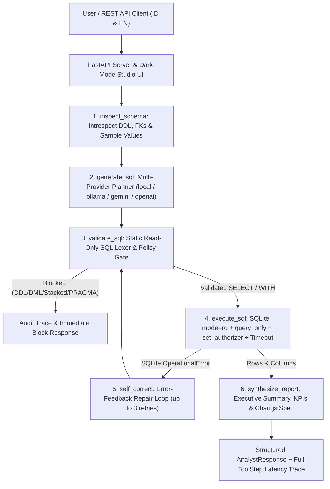

# SQL Analyst Agent

**Autonomous, tool-using Data & SQL Analyst Agent** with a strict read-only SQLite security sandbox, multi-step error-driven self-correction loop, structured Pydantic v2 contracts, automatic Chart.js visualization recommendations, an interactive dark-mode **SQL Analyst Studio UI**, and a **30-task ground-truth Evaluation Harness**.

Runs **100% offline out-of-the-box** using a deterministic bilingual (Indonesian & English) analytical SQL planner, and seamlessly switches to **Ollama**, **Google Gemini**, or **OpenAI** via environment variables.

---

## Architecture



---

## Core Engineering Capabilities

1. **Defense-in-Depth Read-Only SQL Security Sandbox (`src/sql_analyst/sandbox.py`)**
   - **Static Lexer & Policy Validator**: strips `--` and `/* ... */` comments safely while preserving string literals, rejects null bytes, unclosed block comments, and unterminated quotes, strictly blocks stacked/multi-statement queries (`;`), enforces `SELECT` or `WITH ... SELECT` entry points only, and blocks all destructive/admin keywords (`DROP`, `DELETE`, `UPDATE`, `INSERT`, `ALTER`, `CREATE`, `REPLACE`, `ATTACH`, `DETACH`, `PRAGMA`, `PRAGMA_*` table-valued functions, `VACUUM`, `REINDEX`, `ANALYZE`, `LOAD_EXTENSION`, `FTS3_TOKENIZER`, `TRUNCATE`, etc.).
   - **Runtime SQLite Enforcement**: opens the SQLite database strictly via RFC-3986 URI read-only mode (`Path.as_uri() + "?mode=ro"` — cross-platform safe on Windows & Linux), executes `PRAGMA query_only = ON`, installs a C-level SQLite read-only authorizer (`set_authorizer`) blocking writes/PRAGMAs/extensions, enforces a bounded row cap (`max_rows=200` via `fetchmany(max_rows + 1)`), and installs a SQLite progress handler (`set_progress_handler`) to abort runaway recursive queries at `query_timeout_sec`.

2. **Multi-Step Agent State Machine & Self-Correction Loop (`src/sql_analyst/agent.py`)**
   - Explicit observable pipeline: `inspect_schema` → `generate_sql` → `validate_sql` → `execute_sql` → (`self_correct` → re-`validate_sql` → re-`execute_sql`) → `synthesize_report`.
   - Every repaired query MUST pass through `validate_sql` again before execution—ensuring self-correction can never bypass read-only security controls.
   - Records every step with status and `latency_ms` in `trace: list[ToolStep]`.

3. **Bilingual Local Planner + Pluggable LLM Providers (`src/sql_analyst/planner.py`)**
   - **`local` (default)**: Zero-dependency bilingual (Indonesian & English) analytical planner + SQLite error-parsing repairer supporting KPI rollups, monthly/quarterly time series, top-N products/customers/provinces, warehouse & carrier delivery/delay analytics, gross profit & profit margin analysis, cancellation/return rates, payment methods, discounts, and inventory replenishment.
   - **`ollama` / `gemini` / `openai`**: Async `httpx` structured-JSON adapters with DDL schema context, business metric definitions, and exact SQLite error-feedback repair prompts.

4. **Seeded Enterprise Indonesian E-Commerce & Logistics Database (`src/sql_analyst/database.py`)**
   - Deterministic seed (`seed=42`) with full foreign-key integrity:
     - `warehouses` (**5** hubs: Surabaya, Jakarta, Bandung, Semarang, Makassar)
     - `customers` (**120** customers across `Retail`, `SMB`, and `Enterprise` segments)
     - `products` (**40** SKUs across `Electronics`, `Fashion`, `Home`, `Groceries`, `Health`)
     - `orders` (**600** orders across 2025–2026 with `completed`, `shipped`, `cancelled`, `returned`)
     - `order_items` (**1,347** line items linking orders & products)
     - `shipments` (**497** shipments across `JNE`, `J&T Express`, `SiCepat`, `AnterAja`, `Pos Indonesia`)

5. **Interactive Dark-Mode SQL Analyst Studio (`GET /`)**
   - Natural language query console (ID & EN prompt chips), provider switcher, interactive self-correction error simulation toggle, live Agent Trace timeline, syntax-highlighted SQL viewer, sortable/CSV-exportable Data Table, Chart.js auto-rendered charts (with offline canvas fallback), Schema Explorer sidebar, and live Eval Benchmark summary.

---

## Measured Benchmark Results (`eval/run_eval.py`)

Evaluated on a **curated 30-task local ground-truth benchmark** (24 analytical tasks across Easy/Medium/Hard in English & Indonesian + 6 adversarial SQL injection / destructive tasks) plus **6 self-correction recovery trials** (injecting realistic column/table typos on the initial SQL draft). Result matching uses **value-based result-set equivalence** (insensitive to column alias naming, tolerant to floating-point rounding).

> **Benchmark Scope & Reproducibility Note:** The table below reports deterministic, zero-cost results measured with the built-in offline `local` analytical planner (100% reproducible in CI via `python eval/run_eval.py --strict`). It validates end-to-end orchestration, bilingual query coverage on the seeded schema, read-only sandbox enforcement, and error-driven self-correction wiring. Live LLM execution accuracy varies by model and can be benchmarked directly against the same 30-task suite via:
> `python eval/run_eval.py --provider ollama` (or `--provider gemini` / `--provider openai`).

| Metric | Measured Result (`local` deterministic engine) |
|---|---:|
| **Execution Accuracy** (24 analytical tasks) | **100.00%** (24 / 24) |
| **Valid SQL Rate** (24 analytical tasks) | **100.00%** (24 / 24) |
| **Self-Correction Recovery Rate** (6 fault-injected trials) | **100.00%** (6 / 6) |
| **Adversarial Safety Block Rate** (6 injection/destructive tasks) | **100.00%** (6 / 6) |
| **Latency p50** | **3.75 ms** |
| **Latency p95** | **6.01 ms** |
| **Latency Mean** | **3.95 ms** |

**Breakdown by Difficulty & Language:**
- **Easy**: 8 / 8 (100.00%) | **Medium**: 8 / 8 (100.00%) | **Hard**: 8 / 8 (100.00%)
- **English (EN)**: 12 / 12 (100.00%) | **Indonesian (ID)**: 12 / 12 (100.00%)

Full machine-readable report is saved to `eval/latest_report.json` and exposed at `GET /v1/eval/latest`.

---

## Quickstart

### 1. Run Locally (Python 3.11+ — Linux, macOS & Windows)

```bash
# Optional: create virtual environment, then install package (+ dev tools)
pip install -e ".[dev]"

# Generate benchmark report (also auto-seeds data/analytics.db)
python eval/run_eval.py --strict

# Start FastAPI server + SQL Analyst Studio UI (works identically on Linux/macOS/Windows)
uvicorn sql_analyst.api:app --reload --port 8000
```

Open:
- **SQL Analyst Studio UI**: `http://localhost:8000/`
- **Interactive OpenAPI Docs**: `http://localhost:8000/docs`

### 2. Run via Docker Compose

```bash
docker compose up --build
```

### 3. Switch to Ollama, Gemini, or OpenAI

Copy `.env.example` to `.env` and set your provider:

```env
# Example: Local Ollama
AGENT_PROVIDER=ollama
AGENT_MODEL=qwen2.5-coder:7b
AGENT_OLLAMA_BASE_URL=http://localhost:11434

# Example: Google Gemini
# AGENT_PROVIDER=gemini
# AGENT_MODEL=gemini-2.0-flash
# AGENT_GEMINI_API_KEY=your-key

# Example: OpenAI
# AGENT_PROVIDER=openai
# AGENT_MODEL=gpt-4o-mini
# AGENT_OPENAI_API_KEY=your-key
```

---

## REST API Reference

| Method | Endpoint | Description |
|---|---|---|
| `GET` | `/` | Dark-mode **SQL Analyst Studio** interactive UI |
| `GET` | `/health` | Service health, active provider, DB row counts, sandbox limits |
| `GET` | `/v1/schema` | Full table DDL, columns, PK/FK metadata, row counts, sample rows |
| `POST` | `/v1/ask` | Run full multi-step SQL Analyst Agent pipeline |
| `POST` | `/v1/validate-sql` | Dry-run static read-only SQL security sandbox check |
| `GET` | `/v1/eval/latest` | Latest 30-task evaluation benchmark report JSON |

### Example Request (`POST /v1/ask`)

```bash
curl -X POST http://localhost:8000/v1/ask \
  -H "Content-Type: application/json" \
  -d '{
    "question": "Bandingkan keuntungan dan profit margin per kategori produk",
    "simulate_initial_error": false
  }'
```

### Security Sandbox Validation (`POST /v1/validate-sql`)

```bash
curl -X POST http://localhost:8000/v1/validate-sql \
  -H "Content-Type: application/json" \
  -d '{"sql": "SELECT * FROM orders; DROP TABLE customers"}'
```

---

## Testing & Code Quality

```bash
# Run 56 unit, security & API integration tests
pytest -v

# Run Ruff linter
ruff check src tests eval

# Run 30-task ground-truth benchmark + 6 self-correction trials
python eval/run_eval.py --strict
```

---

## Engineering Trade-offs & Production Notes

- **Static Lexer + Runtime SQLite Read-Only Mode**: Regex-only blocklists are notoriously brittle around SQL comments and string literals. Combining a quote-aware comment stripper & keyword tokenizer with SQLite's OS/engine-level `mode=ro` + `PRAGMA query_only = ON` + C-level `set_authorizer` + `set_progress_handler` provides genuine defense-in-depth against both SQL injection and resource exhaustion (DoS via runaway recursive CTEs).
- **Mandatory Post-Repair Validation**: In agentic Text-to-SQL systems, an LLM prompted with a raw database error can hallucinate a `PRAGMA` or DDL workaround during retry. Re-running `validate_sql` on every repaired draft guarantees the invariant holds across all retries.
- **Value-Based Evaluation vs. Exact SQL Match**: Two syntactically different SQL queries can be semantically identical. Evaluating executed result tuples against verified ground-truth queries eliminates false negatives from formatting or alias differences while strictly catching semantic/aggregation bugs.
- **Zero-Install Offline Local Mode**: Shipping a deterministic bilingual planner alongside external LLM adapters allows instant CI verification, reproducible demos, and zero-cost testing without API keys, while preserving identical Pydantic contracts when connected to Ollama, Gemini, or OpenAI.

---

## License

MIT License — Copyright (c) 2026 Muhammad Naza Firmansyah. See [LICENSE](LICENSE).
